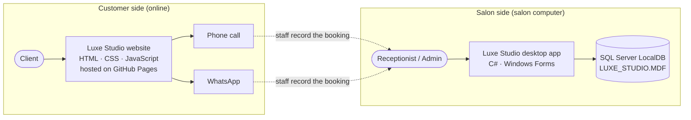

# Hi, I'm Noel Kabaka 👋

**Web Developer · Software Developer · IT Support Specialist · Database Administrator · System Analyst**

I build clean, efficient, user-friendly systems that solve real problems for small businesses. I'm open to projects that push the boundaries of innovation.

📧 [noelmunyuma@gmail.com](mailto:noelmunyuma@gmail.com) · 📞 0717218062

---

## 🌱 About me
I studied **Applied Computing** and learnt **C++**, where I built a burger system. I kept growing through **freeCodeCamp** and went on to build a full salon platform, Luxe Studio, with a public website and a management system behind it.

✏️ *Add one line about what your burger system did (for example, taking orders or calculating totals).*

## 🎯 Target roles
- Web Developer
- Software Developer
- IT Support Specialist
- Database Administrator
- System Analyst

## 📚 Currently learning
- **Python**
- Advancing my skills and elevating my software engineering capabilities through **freeCodeCamp**

---

## ⭐ Featured project: Luxe Studio

🔗 **Live website:** [nowie4678.github.io/Luxe_Studio](https://nowie4678.github.io/Luxe_Studio/)

### The problem
Salons often run on notebooks, phone calls and memory. That leads to double-booked stylists, lost client details, billing mistakes and no clear picture of income.

### The solution
Luxe Studio has two parts:
1. **A customer website** where clients see the services, team, reviews and FAQs, and can book, call or order on WhatsApp.
2. **A salon management system** (desktop app) where staff handle bookings, clients, billing and reports in one place.

### Evidence that it works

| Customer website | Booking form in the management system |
|---|---|
|
### Architecture

### What I built and how

**The website**
- Built with HTML, CSS and JavaScript, with Home, Services, Team, Reviews, FAQ and Contact sections
- Calls to action: Book Now, Book Appointment, Order on WhatsApp, Call, and a promo code banner
- Published for free with GitHub Pages

**The management system** (C#, Windows Forms, SQL Server LocalDB)
- **Database:** designed tables for appointments, clients, services, billing and staff
- **Appointments:** booking form with validation and a check that stops a stylist being booked twice at the same time
- **Clients:** searchable client list with last visit and number of visits worked out from bookings
- **Services:** price list that drives billing
- **Billing:** discounts, payment methods (Cash, M-Pesa, Card) and printable receipts
- **Reports:** revenue, appointments and top service for any date range, with print and PDF export
- **Dashboard:** today's appointments and income at a glance
- All database queries use parameters, and the app checks every input before saving

### Tech stack

**Languages:** C++ · C# · JavaScript · SQL · Python (learning)
**Frontend:** HTML · CSS
**Databases:** SQL Server (LocalDB) · MySQL
**Tools:** Git · GitHub · Visual Studio

---

## 💡 Lessons learnt
- **Check the database before writing code.** Mismatched column names (for example `Name` vs `FullName`, `Id` vs `ClientId`) caused errors until I looked at the real table structure first.
- **Data must match across tables.** A booking only gets a price if its service name matches the price list exactly, so I now load the dropdowns from the database instead of typing names twice.
- **Build and test one form at a time.** Small steps made problems easy to find.
- **Validate everything.** Checking inputs before saving prevents bad data and crashes.
- **Read error messages carefully.** They usually name the exact problem.

## 🚀 What I will improve
- Learn **Python** and use it for automation and data work
- Connect the website to the database so clients can **book online** directly
- Add **user roles and secure password storage** to the login
- Add **automated testing** and regular **database backups**
- Move the database to a shared server so several computers can use the system at once
- Make the website fully **mobile-friendly** and improve **documentation**

---

## 📊 GitHub stats

## 📫 Let's connect
I'm open to projects that push the boundaries of innovation. Drop me a message:

  

  noelmunyuma@gmail.com

📞 **0717218062**
